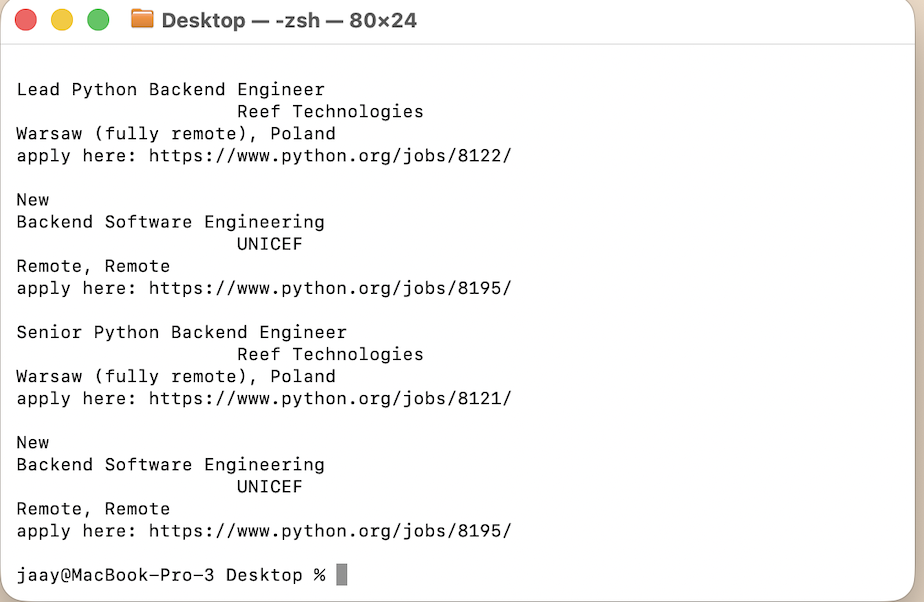
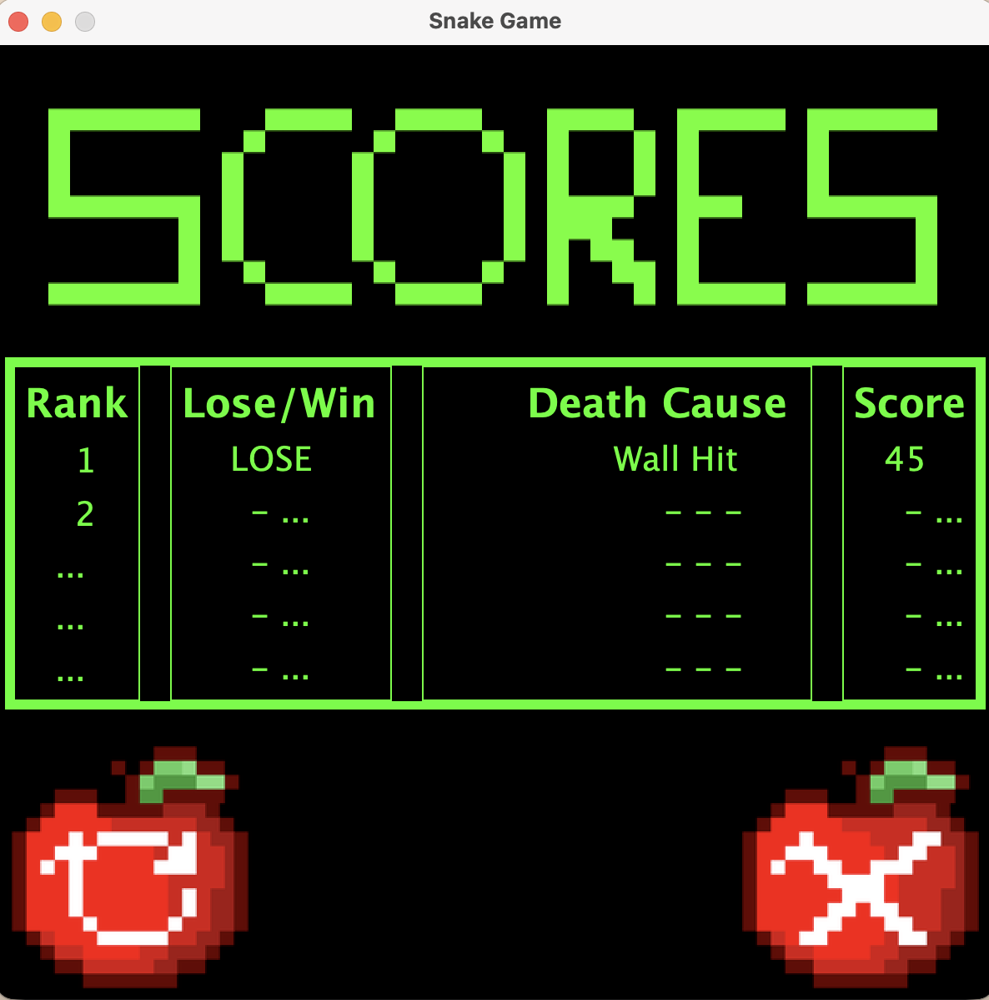
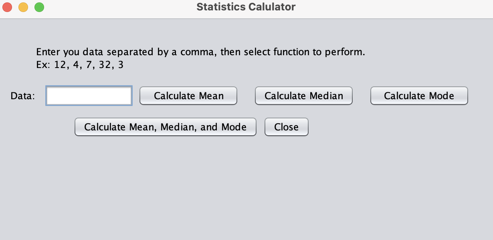
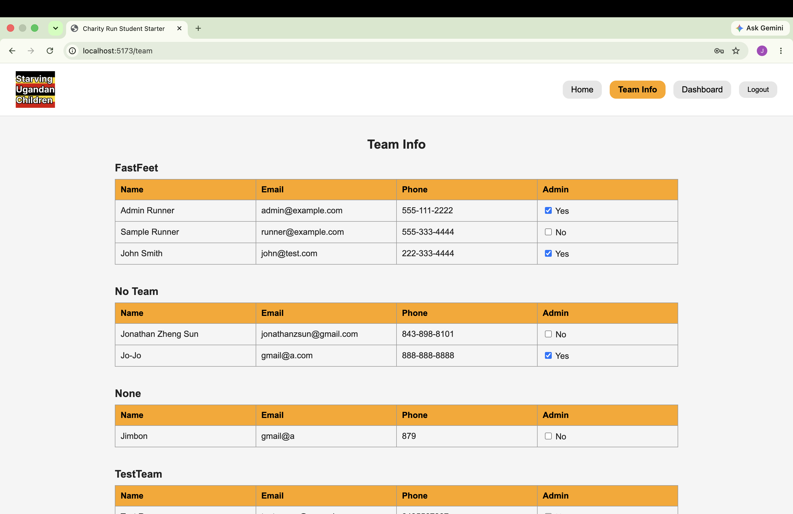

Portfolio
=========

Programming Projects
--------------------

*For access to my private project repositories, please [email me](mailto:example@csustudent.net?subject=GitHub%20Access) with the subject line, GitHub Access.

---
### [Python Final Project | CSCI 301](project1)

---
### [Snake Game Leaderboard | CSCI 325](project2)

---
### [Statistics Calculator | CSCI 325](project3)

---
### [Charity Run Website | CSCI 334](project4)

---

Ethics Papers
-------------

### [Ethical Implications of AI on Database Administrators](/pdf/EthicsPaperAI.pdf)

-   **Class:** CSCI 301 - Survey of Scripting Languages
-   **Grade:** N/A 

### [Ethical Challenges in Generative AI Misuse](/pdf/APNEthicsPaper.pdf)

-   **Class:** CSCI 332 - Applied Networking
-   **Grade:** N/A

### [A Reflection on Jeremiah 17:9 in Network Penetration Testing](/pdf/EthicsEssay.pdf)

-   **Class:** CSCI 452 - Network Penetration Testing
-   **Grade:** N/A 

---

Presentations
-------------

### [Cryptography – Group Project | CSCI 352](/pdf/HandsOnProjectPowerpoint.pdf)

- **Class:** CSCI 352 - Cyber Defense
- **Group Members:** Jalyn Green & Ruth Knotts
- **My Contributions:** Collaborated on the step-by-step handout & answer key for an interactive cryptography Google Form activity. 
- **Additional Credit:** Ruth Knotts created the video explanation.

**Project Materials:**
- [Step-by-Step Handout](/pdf/StepByStepHandout.pdf)
- [Answer Key](/pdf/AnswerKey.pdf)

- **Grade:** N/A

### [Cyberbullying](/pdf/Cyberbullying.pdf)

- **Class:** CSCI 405 - Principles of Cybersecurity
- **Grade:** N/A

---

Page template forked from <a href="https://github.com/csu-cs/csci-portfolio">CSU-CS</a>

<!-- Remove above link if you don't want to attributive -->
