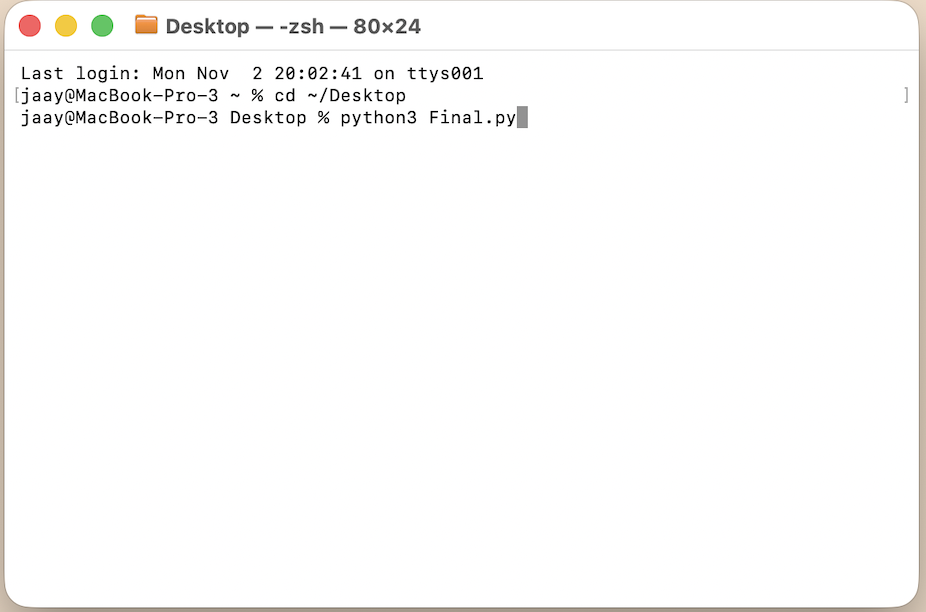
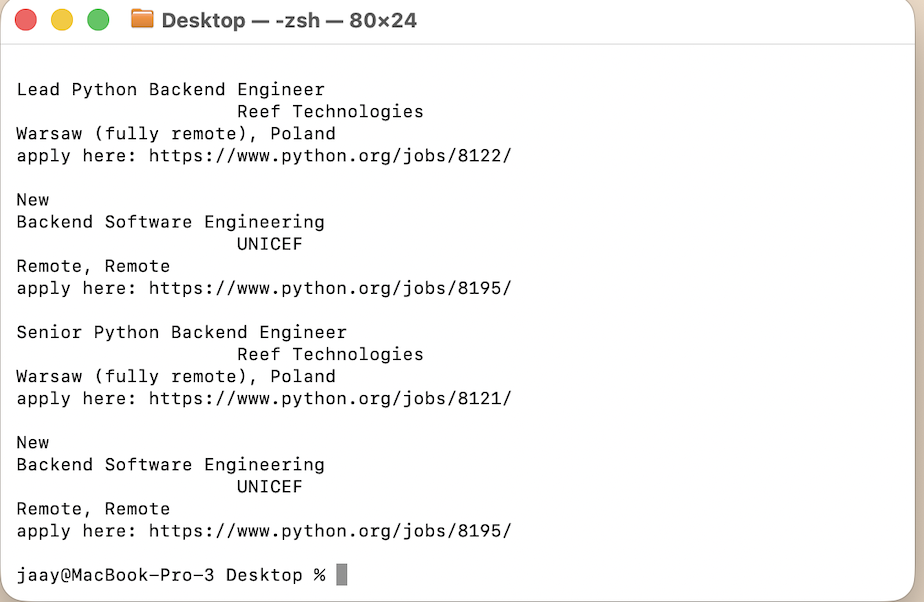

[Back to Portfolio](./)

Project 1 - Python Final Project
===============

-   **Class:** CSCI 301 - Survey of Scripting Languages 
-   **Grade:** N/A
-   **Language(s):** Python
-   **Source Code Repository:** [CSCI 301 Final Project](https://github.com/jalyng-ux/CSCI-301-code-repository/tree/master/FinalProject)

(Please [email me](mailto:JTGreen@student.csuniv.edu?subject=GitHub%20Access) to request access.)
  
## Project description

For my final project in CSCI 301, I created a Python web scraping program that searches for engineering job listings on the Python.org jobs website. This was designed so that the program uses the Requests library to retrieve information from the website and BeautifulSoup to search through the HTML. It identifies job listings containing the word "engineer" and displays the company name, job location, and a link to the job posting. I really enjoyed learning more about Python throughout this course and seeing how it can be used to collect useful information from websites. Overall, this project helped me improve my Python scripting skills and gain a better understanding of web scraping and extracting information from websites.

## How to Properly Run the Program 

In order to run this project, Python 3 must be installed on your computer. The Requests and BeautifulSoup libraries are also required.

- **Steps:**
1. Download the Final.py file from the GitHub repository.
2. Open a terminal or command prompt in the folder containing the file.
3. Install the required libraries using this command:

   "pip install requests beautifulsoup4"

4. Run the program using this command:

   "python3 Final.py"

5. The program will search the Python.org jobs website and display matching engineering job listings. It will also include the company name, location, and job posting link.

## UI Design

This project uses a command-line interface rather than a graphical user interface. When running he Python script, the program automatically searches the Python.org jobs website for engineering job listings. The results are displayed directly in the terminal, showing the company name, job location, and a link to the job posting.

**IMPORTANT NOTE:**
- You do not need to enter any information because the program performs the search automatically.

Fig 1. Running the Python program using Terminal.

Fig 2. Engineering job listings displayed in Terminal.

## Additional Considerations

One thing to keep in mind with this project is that it needs an internet connection to work. Since the program gets its information directly from Python.org. Any changes to the website could affect how it runs. Also, the results may be different depending on what engineering jobs are posted at the time.

[Back to Portfolio](./)
