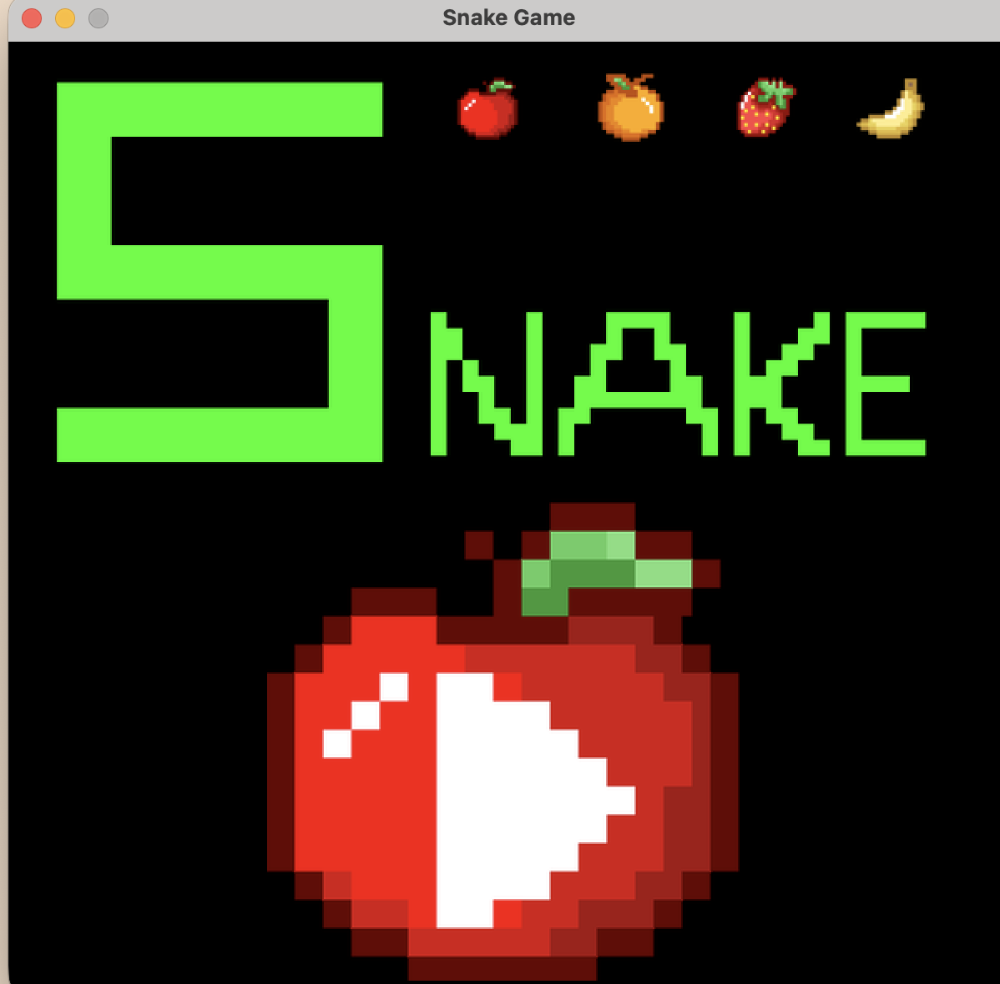
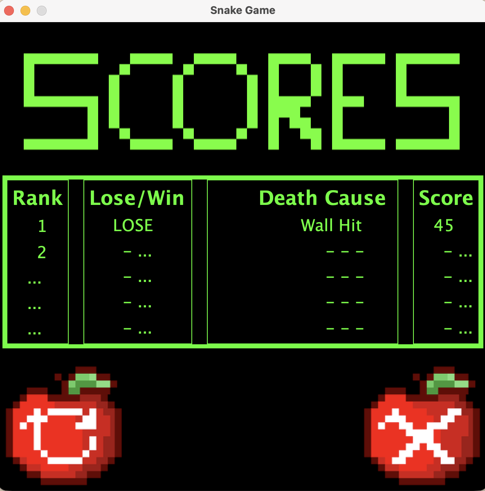

[Back to Portfolio](./)

Project 2 - Snake Game Leaderboard
===============

-   **Class:** CSCI 325 - Object-Oriented Programming 
-   **Grade:** 90/100
-   **Language(s):** Java
-   **My Contribution:** Leaderboard Functionality
-   **Source Code Repository:** [CSCI 325 Snake Game](https://github.com/csu-cs/csci325-Fall25-Snake)

(Please [email me](mailto:JTGreen@student.csuniv.edu?subject=GitHub%20Access) to request access.)
  
## Project description

For this group project in CSCI 325, my team and I created a Snake Game using Java. The game allows players to control a snake, collect fruit, and earn points. Each team member was responsible for different parts of the game. My main responsibility was creating the leaderboard functionality. I worked on the Leaderboard.java file, which keeps track of the player's score, records whether they won or lost, and saves the reason the game ended. I also added a feature that organizes the scores from highest to lowest and keeps the top five scores. I enjoyed working on this project because it gave me more experience with java and showed me how different parts of a program come together when working with a team. Other team members worked on the game's interface, graphics, and sound effects.

## How to Properly Run the Program 

In order to run this project, Java and Apache NetBeans must be installed on your computer.

Steps:
1. Download the Snake Game project from the GitHub repository.
2. Extract the downloaded ZIP file.
3. Open Apache NetBeans.
4. Select File > Open Project.
5. Find and open the CSCI325_Snake folder.
6. Click the green Run button to start the game.
7. Once the game opens, the player can start playing, collect fruit to earn points, and view their scores on the leaderboard.

## UI Design

This project uses a graphical user interface that allows players to interact with the Snake Game. Players can control the snake, collect fruit to earn points, and view their results after the game ends. The leaderboard displays the top five scores, whether the player won or lost, and the reason the game ended. My contribution focused on the code that keeps track of this information, while another team member worked on the visual design of the leaderboard.

Fig 1. The Snake Game start screen.

Fig 2. The leaderboard displaying the player's score, game result, and reason the game ended.

[Back to Portfolio](./)
