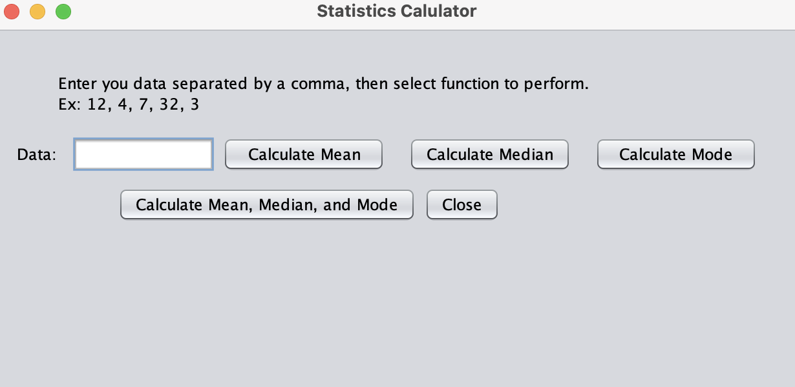
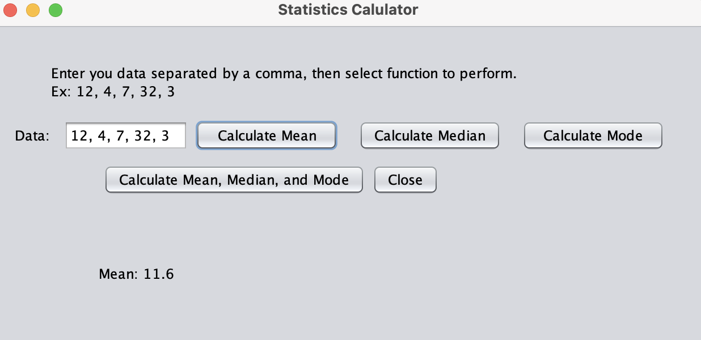
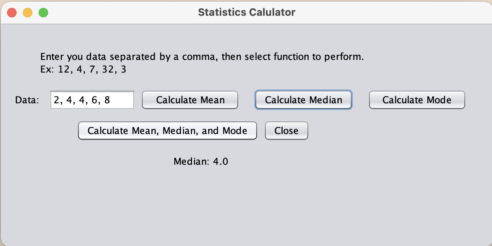
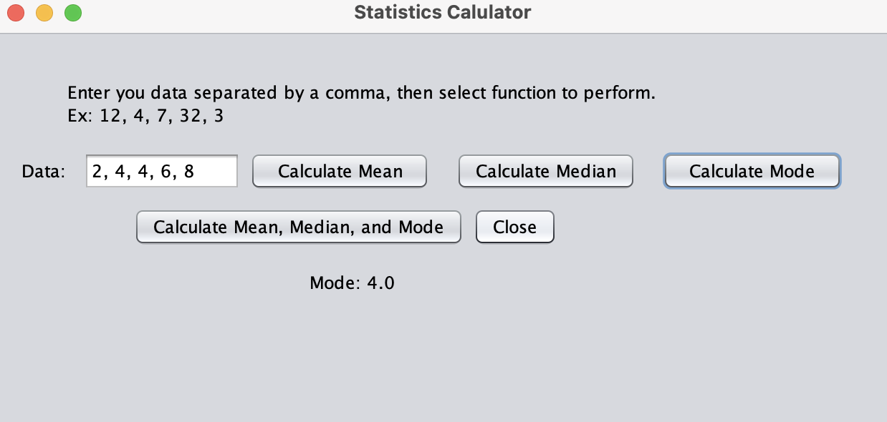
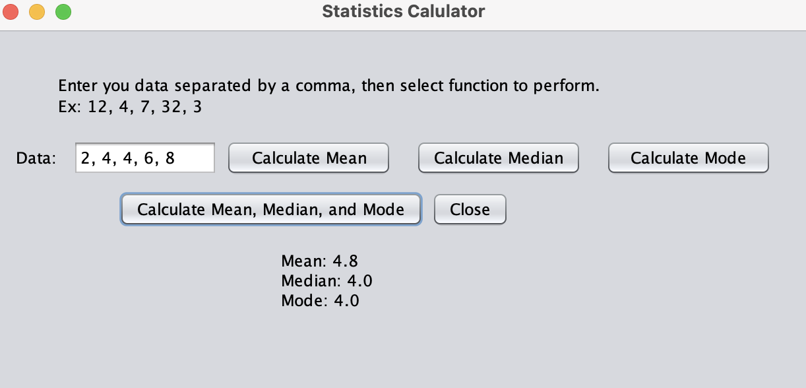

[Back to Portfolio](./)

Project 3 - Statistics Calculator
===============

-   **Class:** CSCI 325 - Object-Oriented Programming
-   **Grade:** N/A
-   **Language(s):** Java
-   **Source Code Repository:** [Statistics Calculator Code](StatisticsCalulatorGUI2.java)

(Please [email me](mailto:JTGreen@student.csuniv.edu?subject=GitHub%20Access) to request access.)

## Project description
- For this project, I created a Statistics Calculator using Java and Apache NetBeans. I designed a graphical user interface (GUI) that allows users to enter numbers and calculate the mean, median, and mode. I created buttons for each calculation and an additional button that displays all three results together. I used arrays, loops, and if/else statements to perform the calculations.

## How to Properly Run the Program 

- **Steps:**
1. Open the project in Apache NetBeans.
2. Run the StatisticsCalculatorGUI2.java file.
3. Enter numbers separated by commas.
4. Click Calculate Mean, Calculate Median, Calculate Mode, or Calculate Mean, Median, and Mode.
5. The answer will appear below the buttons.
6. Click Close to exit the calculator.

## UI Design

Fig 1. Main calculator interface before entering numbers.

Fig 2. Calculator displaying the mean of the entered numbers.

Fig 3. Calculator displaying the median of the entered numbers.

Fig 4. Calculator displaying the mode of the entered numbers.

Fig 5. Calculator displaying the mean, median, and mode together.

## Additional Considerations
This project was originally intended for my CSCI 325 coursework but was not submitted for grading. I later completed it independently to further develop my Java programming skills and gain additional experience with GUI development.

[Back to Portfolio](./)
