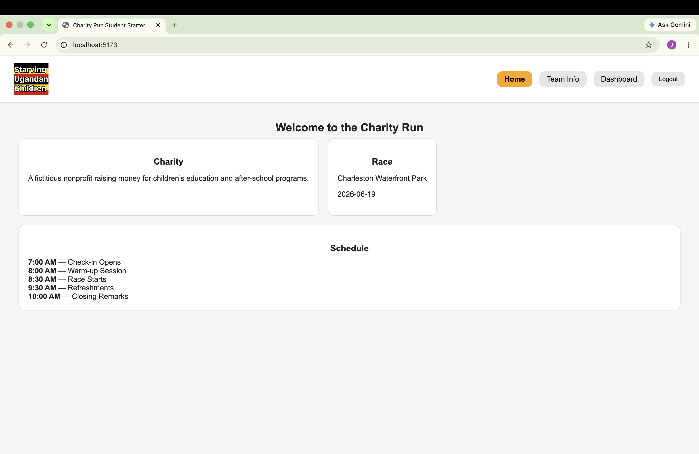
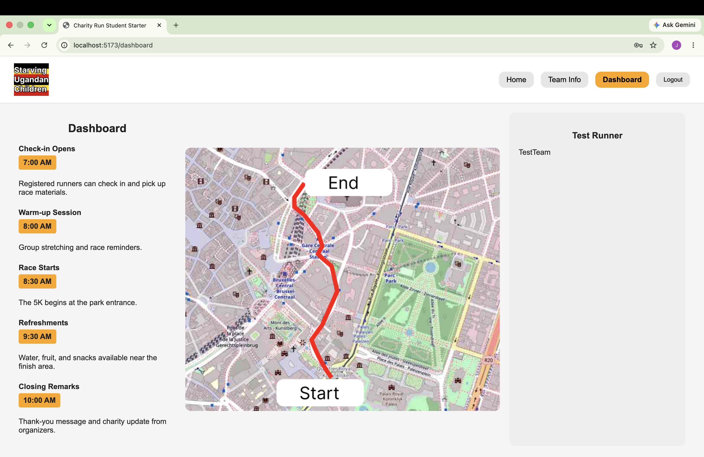
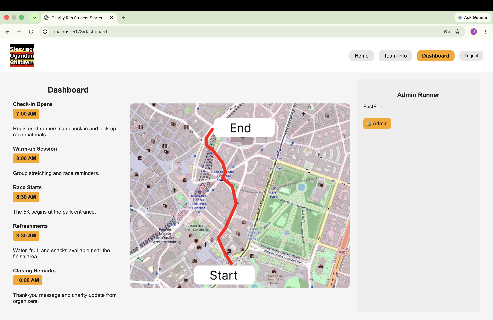
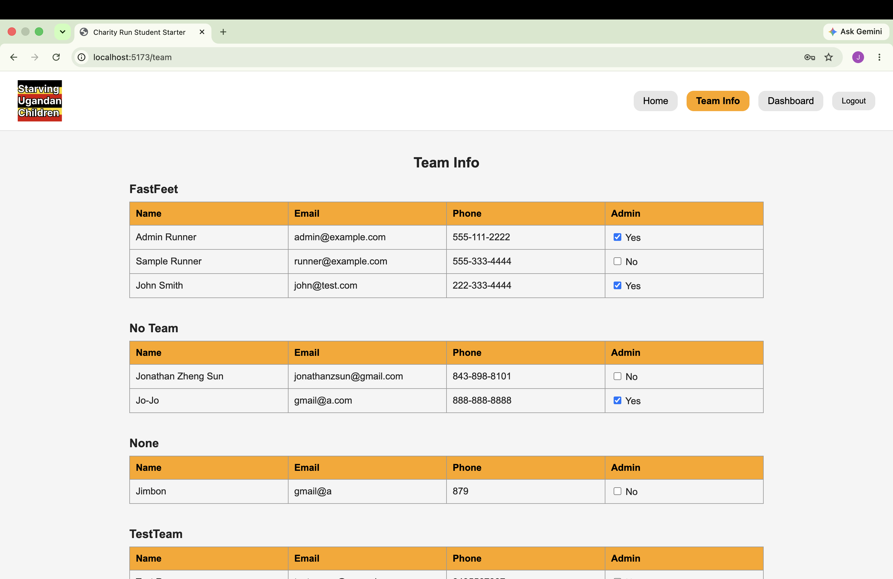

[Back to Portfolio](./)

Project 4 - Charity Run Website
===============

- **Class:** CSCI 334 - User-Interface Programming 
- **Grade:** N/A
- **Language(s):** JavaScript, React, HTML, CSS, C#
- **Project Type:** Group Project
- **My Contribution:** Frontend JavaScript development, Admin View functionality, & testing
- **Source Code Repository:** [Charity Run Website](https://github.com/Krabbenhoft/team-website-public)
  
## Project Description
For this group project in CSCI 334, my team and I developed a Charity Run Website that allows users to register, log in, join teams, and manage information related to a charity run webpage. The website was developed using React and JavaScript for the frontend and C# with .NET for the backend. My main responsibility was working on the frontend Admin View. I worked with JavaScript to connect the admin interface to existing backend functions, allowing administrators to view runner information and manage admin privileges. I also worked on the functionality of the checkboxes within the Admin View and helped test the frontend and the backend. This project allowed me to gain more experience with JavaScript and React while developing a better understanding of how the frontend and backend communicate.

## How to Properly Run the Program 
In order to run this project, Node.js, npm, and the .NET SDK are needed.

**Steps:**
1. Download the Charity Run Website project from the GitHub repository.
2. Extract the downloaded ZIP file.
3. Open a terminal and navigate to the charity-run-backend-net10 folder.
4. Start the backend using:

   "dotnet run"

5. Open another terminal and navigate to the running-website folder.
6. Install the frontend dependencies using:

   "npm install"

7. Start the frontend using:

   "npm run dev"

8. Open the local website address displayed in the frontend terminal.
9. Use the website to explore the registration, login, dashboard, and admin features.

**IMPORTANT NOTE:** 
The frontend uses a backend API address configured in src/api.js. This address may need to be updated if the backend runs on a different port.

## UI Design
The Charity Run Website uses a graphical user interface developed with React and JavaScript. The website includes several pages that allow users to register, log in, view team information, and access different features based on their role. My main focus was the Admin View, which allows administrators to view runner information and manage administrative privileges. I worked on connecting this interface to the backend and implementing the functionality of the checkboxes used within the Admin View. The website was designed to organize information in a way that allows users and administrators to navigate through the different features.

Fig 1. Charity Run website home page.

Fig 2. Dashboard showing the race schedule and route.

Fig 3. The admin account dashboard, showing the administrator role and access to the website's features.

Fig 4. My main contribution to this project was working on the frontend Admin View. I used JavaScript to connect the admin interface to the backend so administrators could view registered runners, their team information, and admin roles.

## Additional Considerations
Since this was a group project, each team member was responsible for different parts of the website. My contribution focused primarily on the frontend Admin View and its functionality. One challenge involved making sure the frontend communicated correctly with the backend and that the interactive features worked as expected. Testing these features helped me gain a better understanding of how different parts of a web application work together. Overall, this project strengthened my understanding of JavaScript, React, and the importance of communication while working in a team. 

[Back to Portfolio](./)

